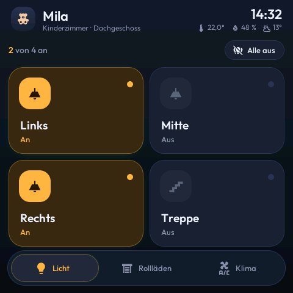
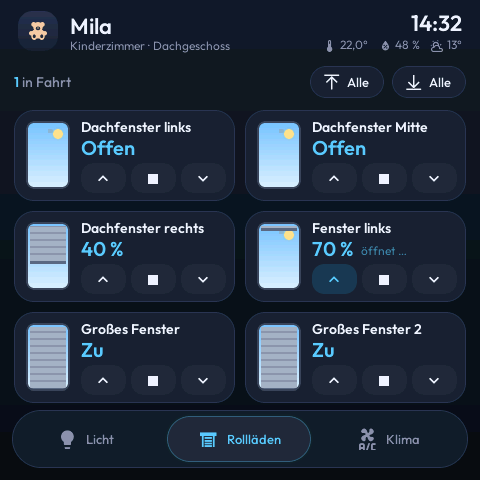
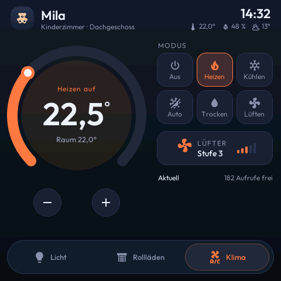
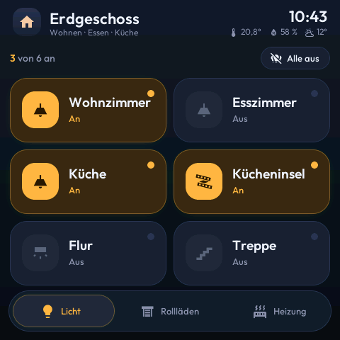
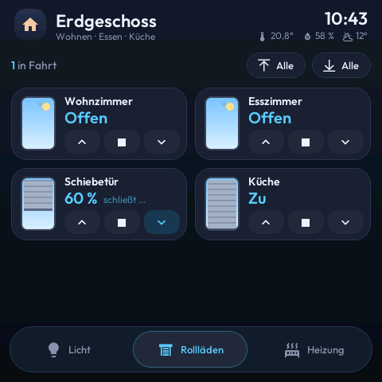
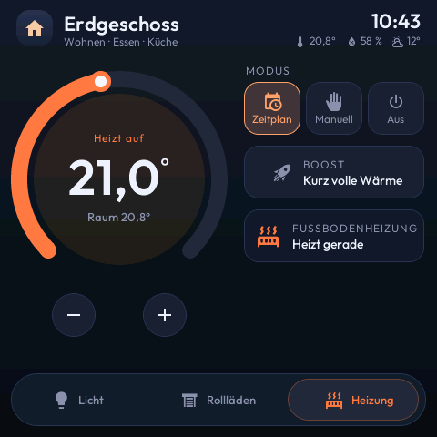

<div align="center">

# 🏠 ESPHome Room Panel

**Raumsteuerung mit Animationen für Licht, Rollläden und Klima auf einem 4″-Touchdisplay**

[](https://esphome.io/)
[](https://www.home-assistant.io/)
[](LICENSE)
[](https://github.com/firsttris/esphome-room-panel/actions/workflows/build.yml)

Ein Panel pro Raum auf dem [Guition ESP32-S3-4848S040](https://devices.esphome.io/devices/guition-esp32-s3-4848s040/) (480 × 480).
Jede Lampe und jeder Rollladen ist eine Zeile in der Raum-Datei.

**Kinderzimmer Mila** (`mila.yml`): 4 Lichter, 6 Rollläden, Klimaanlage

  

**Erdgeschoss** (`eg.yml`): 6 Lichter in flachen Kacheln, 4 Rollläden, Fußbodenheizung

  

<sub>Screenshots werden bei jeder Änderung automatisch aus der Firmware erzeugt (SDL-Vorschau mit Beispielwerten).</sub>

</div>

---

## ✨ Was es kann

| Seite | Inhalt |
|---|---|
| 💡 **Licht** | Kacheln, die beim Einschalten warm aufglühen, mit Welle beim Antippen; „Alle aus" |
| 🪟 **Rollläden** | Karten mit kleinem Fenster, dessen Behang während der Fahrt mitläuft; ▲ ■ ▼ und „Alle hoch/runter" |
| ❄️ **Klima** | Drehregler (18–32 °C), sechs Modi mit eigener Farbe, Lüfterstufe mit drehendem Symbol |
| 🔥 **Heizung** | Alternative zu Klima: Drehregler für ein Thermostat, Zeitplan / Manuell / Aus, Boost, „heizt gerade" |

Außerdem:

- **Kopfzeile** mit Uhr, Raumtemperatur, Luftfeuchte und Außentemperatur
- **Leiste unten** mit gleitender Markierung, die die Farbe der Seite annimmt
- **Sofortige Rückmeldung:** Kacheln schalten beim Antippen sofort um; bestätigt HA nicht innerhalb von 4 s, zeigen sie wieder den echten Zustand
- **Cloud-schonend:** Klima-Änderungen werden gesammelt und 2 s nach der letzten Berührung gesendet (wichtig für Daikin Onecta mit 200 Aufrufen am Tag)
- **Abdunkeln** nach 1 min, **Ruhemodus** mit großer Uhr nach 3 min, nachts fast dunkel. Die erste Berührung weckt nur auf und schaltet nichts.
- **Ladebildschirm** bis Home Assistant verbunden ist, danach rotes Wolken-Symbol bei Verbindungsverlust

## 📋 Voraussetzungen

| | |
|---|---|
| **Hardware** | Guition ESP32-S3-4848S040 |
| **ESPHome** | 2026.7 oder neuer (lokal oder als Container, siehe `docker-compose.yml`) |
| **Home Assistant** | ESPHome-Integration, beim Gerät **„Gerät darf Home-Assistant-Aktionen ausführen"** aktivieren |

## 🚀 Einrichten

```bash
git clone https://github.com/firsttris/esphome-room-panel.git
cd esphome-room-panel
cp secrets.example.yaml secrets.yaml   # WLAN, API-Schlüssel, Hotspot-Passwort eintragen
docker compose up -d                   # ESPHome-Dashboard auf http://localhost:6052
```

Das Display per USB anschließen, im Dashboard `mila.yml` → **Install** → **Plug into this computer**.
Danach gehen Updates über WLAN.

> Klappt das Flashen nicht: **BOOT** gedrückt halten, kurz **RST** drücken, BOOT loslassen.

## 🧩 Einen Raum anlegen

`mila.yml` kopieren und anpassen. Oben stehen Name, Symbol und die Entitäten für „Alle"-Knöpfe, darunter eine Zeile pro Gerät:

```yaml
packages:
  core: !include core/index.yml

  light_links: !include
    file: tiles/light.yml
    vars: { uid: links, entity_id: switch.licht_links, text: Links, icon: "\U000F0769" }

  cover_fenster: !include
    file: tiles/cover.yml
    vars: { uid: fenster, entity_id: cover.rollladen_fenster, text: Fenster, travel_time: 25 }

  climate: !include
    file: tiles/climate.yml
    vars: { entity_id: climate.klima, calls_entity: sensor.klima_verbleibende_fur_tag }
```

| Baustein | vars |
|---|---|
| `tiles/light.yml` | `uid`, `entity_id` (switch/light/input_boolean), `text`, `icon`, optional `compact: true` (flache Kachel, bis zu 6 Lichter) |
| `tiles/cover.yml` | `uid`, `entity_id`, `text`, optional `travel_time` (Sekunden, Standard 30) |
| `tiles/climate.yml` | `entity_id`, `calls_entity` (Sensor mit freien Cloud-Aufrufen) |
| `tiles/thermostat.yml` | `entity_id`, optional `min_temp` / `max_temp` (Standard 15 / 28); im Raum `climate_tab_text: Heizung` und `climate_tab_icon: "\U000F0438"` setzen |

**Platz:** Die Licht-Seite fasst 4 Kacheln (oder 6 mit `compact: true`), die Rollladen-Seite 6 Karten. Pro Raum entweder `climate.yml` oder `thermostat.yml`.
**Icons:** Jedes Symbol muss in `core/fonts.yml` in der passenden Größe stehen (Licht-Kacheln: `icons_28`, Raum-Symbol: `icons_24` und `icons_40`).

## 🖼️ Vorschau am PC

Die Oberfläche lässt sich ohne Display als SDL-Fenster bauen, mit Beispielwerten aus `preview/demo-<raum>.yml`.
`preview/render.sh` baut die Vorschau, tippt die Seiten durch und legt Screenshots in `preview/shots/<raum>/` ab
(braucht ESPHome mit `libsdl2-dev`, `xvfb`, `imagemagick` und `xdotool`):

```bash
sh preview/render.sh mila.yml
```

## 🗂️ Aufbau

```
mila.yml, eg.yml    Räume: Substitutions + eine Zeile pro Gerät
base/               Hardware (Display, Touch), Netzwerk, Hintergrundbeleuchtung
core/
  layout.yml        Stile, Kopfzeile, Leiste, Seiten, Ruhemodus, Ladebildschirm
  logic.yml         Verbindung, Uhr, Raum- und Außentemperatur
  fonts.yml         Outfit + Material Design Icons
  panel.h           Animationen und Zustände (C++)
preview/            SDL-Vorschau, Beispielwerte, Screenshot-Skript
tiles/
  light.yml         Licht-Kachel
  cover.yml         Rollladen-Karte
  climate.yml       Klima-Seite (Klimaanlage)
  thermostat.yml    Heizungs-Seite (Thermostat)
```

## 🙏 Danke

Die Idee „ein `!include` pro Kachel, das sich an eine Seite hängt" stammt aus
[agillis/esphome-modular-lvgl-buttons](https://github.com/agillis/esphome-modular-lvgl-buttons) (MIT).
