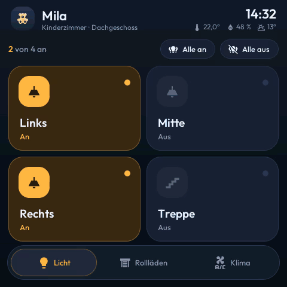
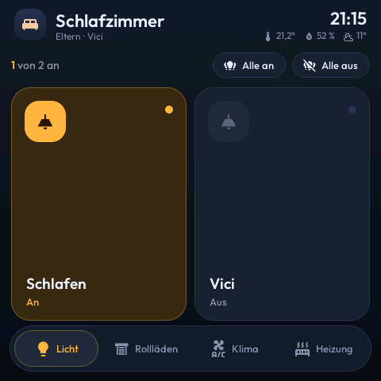
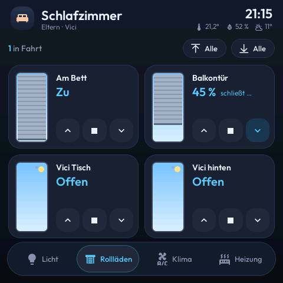
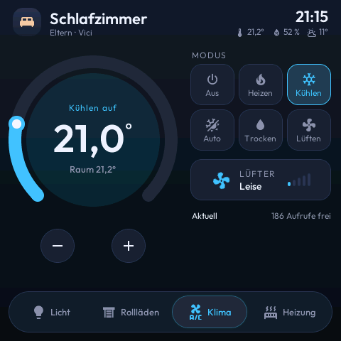
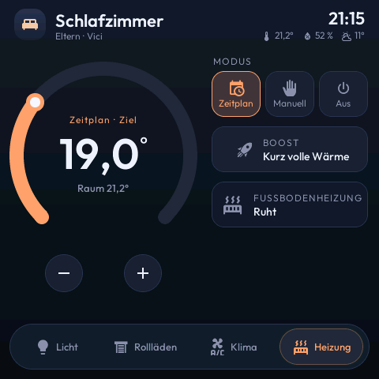

<div align="center">

# 🏠 ESPHome Room Panel

### Animated Home Assistant touch panel for the Guition ESP32-S3-4848S040

**Lights, roller shutters, air conditioning and heating on a 4″ 480 × 480 wall display, built with ESPHome and LVGL.**
Every lamp and every shutter is one line of YAML.

[](https://esphome.io/)
[](https://lvgl.io/)
[](https://devices.esphome.io/devices/guition-esp32-s3-4848s040/)
[](https://www.home-assistant.io/)
[](LICENSE)
<br>
[](https://github.com/firsttris/esphome-room-panel/actions/workflows/build.yml)
[](https://github.com/firsttris/esphome-room-panel/actions/workflows/screenshots.yml)

[Features](#-features) •
[Hardware](#-hardware) •
[Getting started](#-getting-started) •
[Add a room](#-add-a-room) •
[Preview on your PC](#%EF%B8%8F-preview-on-your-pc) •
[Troubleshooting](#-troubleshooting) •
[Related projects](#-related-projects)



<sub>Recorded from the real firmware, built for the desktop with SDL. The user interface is in German; all labels are plain text in the room file.</sub>

</div>

---

## 📸 Screenshots

All screenshots are rendered from the firmware in CI on every change, with sample values.

**Kids' room** ([`mila.yml`](mila.yml)): 4 lights, 6 roller shutters, Daikin air conditioner

  

**Ground floor** ([`eg.yml`](eg.yml)): 6 lights in compact tiles, 4 tall shutter cards, floor heating thermostat

  

**Bedroom** ([`schlafzimmer.yml`](schlafzimmer.yml)): 2 tall light tiles, 4 shutters, air conditioner and heating on four tabs

   

## ✨ Features

| Page | What you get |
|---|---|
| 💡 **Lights** | Tiles that turn warm when switched on, and ceiling lamps that swing like a pendant lamp; "all off" |
| 🪟 **Roller shutters** | Cards with a small window whose shutter moves live while the real one travels, with a sunny sky by day and moon and stars at night; ▲ ■ ▼ and "all up / all down"; tall cards for up to 4 shutters |
| ❄️ **Air conditioning** | Dial (18–32 °C), six modes with their own colour, fan speed with a spinning fan |
| 🔥 **Heating** | Dial for a thermostat, schedule / manual / off, boost, "heating now" |

Also on board:

- **Header** with clock, room temperature, humidity and outdoor temperature
- **Tab bar** with a sliding indicator that takes on the colour of the page; 3 or 4 tabs
- **Instant feedback:** tiles switch the moment you tap; if Home Assistant does not confirm within 4 s, they show the real state again
- **Gentle on cloud APIs:** climate changes are collected and sent 2 s after the last touch, which matters for Daikin Onecta and its 200 calls a day
- **Dimming** after 1 min, **sleep screen** with a large clock after 3 min, almost dark at night. The first touch only wakes the panel and never switches anything.
- **Loading screen** until Home Assistant is connected, then a red cloud icon if the connection drops
- **Smooth text:** fonts and icons with 4-bit anti-aliasing

## 🛒 Hardware

| | |
|---|---|
| **Display** | [Guition ESP32-S3-4848S040](https://devices.esphome.io/devices/guition-esp32-s3-4848s040/): ESP32-S3, 16 MB flash, octal PSRAM, 4″ IPS 480 × 480, capacitive touch (GT911) |
| **Where to buy** | AliExpress or Amazon, search for "ESP32-S3-4848S040" |
| **Mounting** | made for a European 86 mm wall box, power via USB-C. |
| **Firmware size** | about 16 % flash and 36 % RAM, so there is plenty of room for more |

## 🚀 Getting started

| Requirement | |
|---|---|
| **ESPHome** | 2026.7 or newer, locally or as a container (see [`docker-compose.yml`](docker-compose.yml)). CI builds with the release pinned in [`requirements.txt`](requirements.txt) (`pip install -r requirements.txt`), and `docker-compose.yml` runs the same one; Renovate updates both |
| **Home Assistant** | ESPHome integration; tick **"Allow the device to perform Home Assistant actions"** for the panel |

```bash
git clone https://github.com/firsttris/esphome-room-panel.git
cd esphome-room-panel
cp secrets.example.yaml secrets.yaml   # Wi-Fi, API key, fallback hotspot password
docker compose up -d                   # ESPHome dashboard on http://localhost:6052
```

1. Connect the display via USB. In the dashboard choose your room file, e.g. `mila.yml` → **Install** → **Plug into this computer**.
2. Home Assistant finds the new device. Add it with the API key from `secrets.yaml`.
3. In the device options tick **"Allow the device to perform Home Assistant actions"**, otherwise the panel shows states but cannot switch anything.
4. From now on, updates go over Wi-Fi: **Install** → **Wirelessly**.

> 💡 Use a separate API key per device: `openssl rand -base64 32`

## 🧩 Add a room

Copy `mila.yml` and adjust it. At the top are the room name, icon and the entities for the "all" buttons; below that, one line per device:

```yaml
substitutions:
  device_name: panel-living-room
  friendly_name: Panel Living Room
  room_name: Living room
  room_subtitle: "Ground floor"
  room_icon: "\U000F02DC"                       # home
  room_climate: climate.living_room_thermostat  # temperature and humidity in the header
  weather_entity: weather.forecast_home
  # sun_entity: sun.sun                         # day/night sky in the shutter windows (default)
  all_lights: switch.ceiling, switch.sideboard
  all_covers: cover.window, cover.patio_door

packages:
  device: !include base/device.yml
  core: !include core/index.yml

  light_ceiling: !include
    file: tiles/light.yml
    vars: { uid: ceiling, entity_id: switch.ceiling, text: Ceiling, icon: "\U000F0769" }

  cover_window: !include
    file: tiles/cover.yml
    vars: { uid: window, entity_id: cover.window, text: Window, travel_time: 25 }

  climate: !include
    file: tiles/climate.yml
    vars: { entity_id: climate.living_room_ac, calls_entity: sensor.ac_remaining_calls }
```

| Building block | vars |
|---|---|
| [`tiles/light.yml`](tiles/light.yml) | `uid`, `entity_id` (switch / light / input_boolean), `text`, `icon`; optional `compact: true` (flat tiles, up to 6 lights), `height` (e.g. 294 for two tall tiles), `swing: true/false` (pendant swing, default only for the ceiling light icon) |
| [`tiles/cover.yml`](tiles/cover.yml) | `uid`, `entity_id`, `text`; optional `travel_time` (seconds, default 30), `tall: true` (tall cards, up to 4 shutters) |
| [`tiles/climate.yml`](tiles/climate.yml) | `entity_id`, `calls_entity` (sensor with remaining cloud calls) |
| [`tiles/thermostat.yml`](tiles/thermostat.yml) | `entity_id`; optional `min_temp` / `max_temp` (default 15 / 28). As third tab set `climate_tab_text: Heizung` and `climate_tab_icon: "\U000F0438"` in the room. Next to an air conditioner use `page: page_heating`, `tab: 3` and `tabs: 4` in the room. |

**Space:** the lights page holds 4 tiles (6 with `compact: true`), the shutter page 6 cards (4 with `tall: true`).
**Icons:** every icon you use must be listed in [`core/fonts.yml`](core/fonts.yml) in the matching size (light tiles: `icons_28`, room icon: `icons_24` and `icons_40`). Codepoints: [Pictogrammers MDI](https://pictogrammers.com/library/mdi/).

## 🖼️ Preview on your PC

The interface also builds as an SDL window, with sample values from `preview/demo-<room>.yml`.
[`preview/render.sh`](preview/render.sh) builds the preview, taps through the pages and saves screenshots to `preview/shots/<room>/`; with `GIF=1` it also records the demo GIF. It needs ESPHome plus `libsdl2-dev`, `xvfb`, `imagemagick`, `xdotool` and `ffmpeg`:

```bash
sh preview/render.sh mila.yml
GIF=1 sh preview/render.sh mila.yml
```

The [Screenshots workflow](.github/workflows/screenshots.yml) does the same on every push and commits changed images to `docs/`.

## 🗂️ Project structure

```
mila.yml, eg.yml,
schlafzimmer.yml    rooms: substitutions + one line per device
base/               hardware (display, touch), network, backlight
core/
  layout.yml        styles, header, tab bar, pages, sleep screen, loading screen
  logic.yml         connection, clock, room and outdoor temperature
  fonts.yml         Outfit + Material Design Icons
  panel.h           animations and state (C++)
tiles/
  light.yml         light tile
  cover.yml         roller shutter card
  climate.yml       air conditioner page
  thermostat.yml    heating page
preview/            SDL preview, sample values, screenshot, GIF and social image scripts
```

## 🔧 Troubleshooting

| Problem | Solution |
|---|---|
| Flashing over USB fails | Hold **BOOT**, press **RST** briefly, release BOOT, then flash again |
| Panel shows states but nothing switches | Tick **"Allow the device to perform Home Assistant actions"** in the ESPHome integration |
| A tile stays on "--" | The entity ID in the room file does not exist in Home Assistant; check it under Developer tools → States |
| An icon is empty | The glyph is missing in `core/fonts.yml` for that size |
| Air conditioner reacts late | Daikin Onecta polls every 10 min and allows 200 calls a day; a local ESP at the indoor unit (S21 port) removes the limit |
| Text looks jagged | Update to the current version: fonts use `bpp: 4` |
| Is it smooth? | The FPS line at the top shows frames per second, time per frame and copy time; hide it with `show_fps: "false"` |

## 🔗 Related projects

- [**ESPHome Energy Dashboard**](https://github.com/firsttris/esphome-energy-dashboard): energy flow with solar, battery, grid and gas on the same display
- [**kachelwerk**](https://github.com/firsttris/kachelwerk): Home Assistant cards that feel like an app: shutters you drag, lamps with a cone of light, a thermostat dial

## 🙏 Credits

The idea "one `!include` per tile that hooks itself onto a page" comes from
[agillis/esphome-modular-lvgl-buttons](https://github.com/agillis/esphome-modular-lvgl-buttons) (MIT).

## 📄 License

[MIT](LICENSE)
